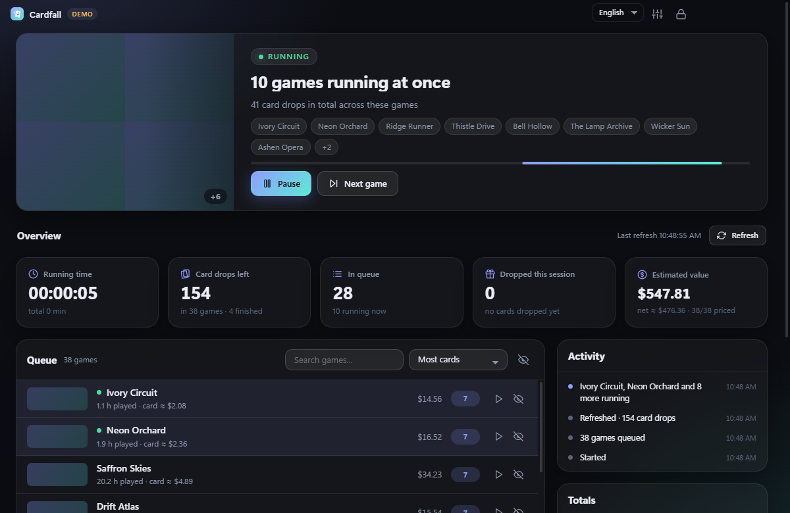
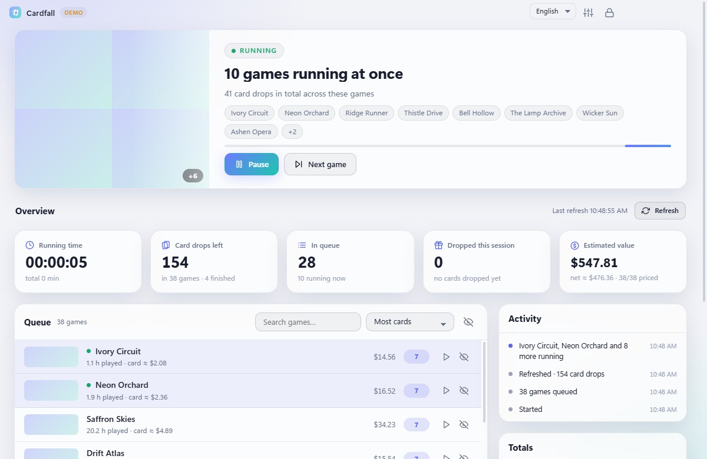
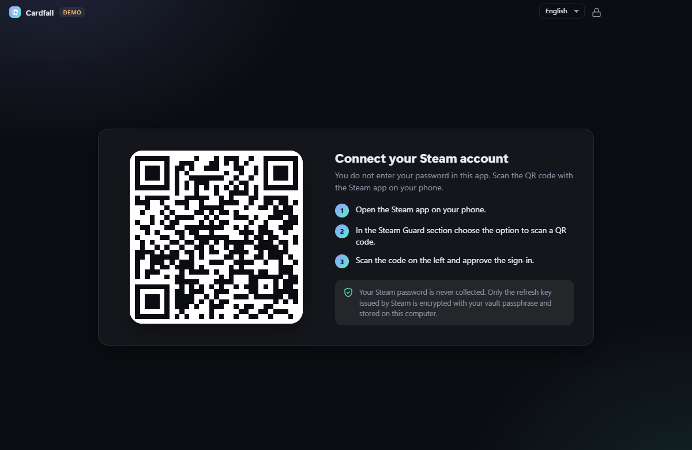
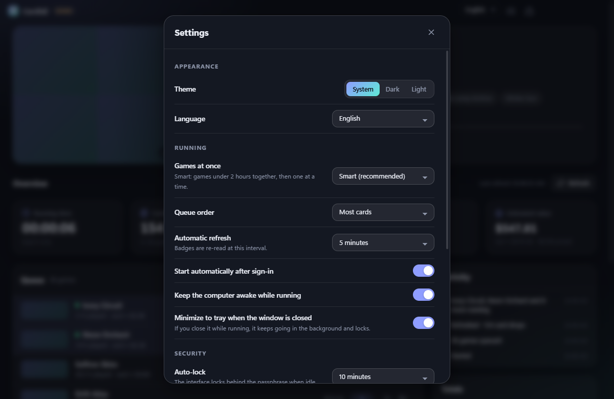

<div align="center">


# Cardfall

**Ein ruhiger, sicherer Steam-Sammelkarten-Idler für Windows.**
Mit QR-Code anmelden, Spiele „laufen“ lassen, Karten fallen sehen.

[](https://github.com/blgymtr/cardfall/actions/workflows/ci.yml)
[](https://github.com/blgymtr/cardfall/releases/latest)
[](LICENSE)

[English](README.md) · **Deutsch** · [Türkçe](README.tr.md)



<sub>Die Screenshots zeigen eingebaute Demodaten (englische Oberfläche).</sub>

</div>

## Download

Lade den Installer aus dem [neuesten Release](https://github.com/blgymtr/cardfall/releases/latest) herunter
(`Cardfall-Setup-<Version>.exe`, Windows 10/11, 64 Bit). Der Installer ist **nicht code-signiert**, deshalb kann
Windows SmartScreen beim ersten Start warnen („Weitere Informationen“ → „Trotzdem ausführen“). Die SHA-256-Prüfsumme steht im Release.

## Funktionen

- **Anmeldung per QR-Code.** Dein Steam-Passwort wird in Cardfall nie eingegeben oder gespeichert.
- **Smarter Betrieb.** Spiele unter 2 Stunden laufen gemeinsam (bis zu 32), danach nacheinander. Alternativ feste 1 bis 32 Spiele.
- **Volle Kontrolle.** Pausieren, nächstes Spiel wählen, ein bestimmtes Spiel sofort starten, Spiele aus der Warteschlange ausblenden.
- **Live-Zahlen.** Laufzeit (Sitzung und gesamt), verbleibende Kartendrops, Spiele in der Warteschlange, in dieser Sitzung gefallene
  Karten und ein geschätzter Wert vom Steam-Marktplatz (abzüglich Steam-Gebühr).
- **Aktualisieren-Knopf** und automatische Aktualisierung, die Abzeichen neu liest und neue Drops zählt.
- **Verträgt sich mit Steam.** Startest du anderswo ein Spiel auf deinem Konto, wartet Cardfall und macht danach weiter.
- **Helles und dunkles Design**, Oberfläche auf **Deutsch, Englisch und Türkisch** (folgt der Systemsprache, jederzeit umschaltbar).
- **Infobereich-Modus.** Schließt du das Fenster im Betrieb, läuft Cardfall im Hintergrund weiter und sperrt die Oberfläche.

## Sicherheit

| Maßnahme | Details |
|---|---|
| Kein Passwort, QR statt Eingabe | Dein Steam-Passwort gelangt nie in die App |
| Verschlüsselter Tresor | Der Steam-Erneuerungsschlüssel wird mit AES-256-GCM verschlüsselt (Schlüssel aus deiner Passphrase per scrypt, N=2^16) und zusätzlich mit Windows DPAPI geschützt |
| Versuchslimit | Wachsende Wartezeit nach 3 Fehlversuchen, nach 10 wird der Tresor gelöscht |
| Automatische Sperre | Bei Inaktivität, Windows-Sperre, Ruhezustand und beim Ausblenden in den Infobereich. Der Betrieb läuft gesperrt weiter |
| Nichts sichtbar im gesperrten Zustand | Die gesperrte Oberfläche bekommt weder Spielliste noch Kontodaten |
| Isolierte Oberfläche | `contextIsolation`, Sandbox, kein Node, strenge CSP mit `connect-src 'none'`, die Oberfläche hat keinen Internetzugriff |
| Schmale IPC-Schnittstelle | Nur validierte Aufrufe von der eigenen Seite der App werden akzeptiert |
| Netzwerk-Allowlist | Nur `steamcommunity.com`, `api.steampowered.com` und das Steam-CDN über HTTPS |
| Gehärtetes Electron | `RunAsNode` und `--inspect` aus, nur Laden aus asar, asar-Integritätsprüfung |
| Privat | Keine Telemetrie, keine Werbung, keine Update-Pings, keine offenen Ports |

Bedrohungsmodell und Meldeweg stehen in der [Sicherheitsrichtlinie](SECURITY.md) (englisch).

## Erste Schritte

1. Cardfall installieren und starten.
2. Eine Passphrase wählen. Sie schützt deine gespeicherte Steam-Sitzung auf diesem Computer.
3. In der Steam-App auf dem Handy **Steam Guard** öffnen, den von Cardfall angezeigten QR-Code scannen und bestätigen.
4. Cardfall liest deine Abzeichen und beginnt. Fertig.

<details>
<summary>Weitere Screenshots</summary>





</details>

## Gut zu wissen

- Steam vergibt erst nach etwa **2 Stunden** Spielzeit Karten für ein Spiel. Neue Spiele fangen daher später an zu droppen.
- Drops sind zufällig und werden von Steam bestimmt. Cardfall hält deine Spiele „im Spiel“, es steuert nicht, wann eine Karte erscheint.
- Startest du ein Spiel am selben PC, fragt Steam, ob die andere Sitzung beendet werden soll. Cardfall erkennt das und wartet.
- Geschätzte Werte stammen aus aktuellen Angeboten des Steam-Marktplatzes und sind nur ein grober Anhalt. Preise werden langsam geladen, weil der Marktplatz Anfragen begrenzt.
- Deine Daten liegen in `%APPDATA%\Cardfall`. **Einstellungen → Alle lokalen Daten löschen** entfernt alles.

## Haftungsausschluss

Cardfall ist ein unabhängiges Hobbyprojekt. Es steht in keiner Verbindung zu Valve Corporation und wird von Valve weder unterstützt noch gesponsert.
Steam und das Steam-Logo sind Marken der Valve Corporation. Das „Idlen“ von Spielen zum Sammeln von Sammelkarten ist weit verbreitet,
du nutzt die Software aber auf eigenes Risiko und bist selbst für die Einhaltung des Steam-Abonnentenvertrags verantwortlich.

## Entwicklung

```bash
npm install        # ggf. zusätzlich: node node_modules/electron/install.js
npm run demo       # Oberfläche mit Fake-Daten öffnen, ohne Steam-Verbindung
npm test           # Unit-Tests
npm run dist       # release/Cardfall-Setup-<Version>.exe bauen
```

Aufbau: `src/main` (Tresor, Steam-Sitzung, Engine, Sicherheit), `src/preload` (IPC-Brücke),
`src/renderer` (Oberfläche und Übersetzungen in `i18n.js`). Eine neue Sprache entsteht durch eine weitere Spalte in `src/renderer/i18n.js`.
Issues und Pull Requests sind willkommen.

## Lizenz

[MIT](LICENSE) © 2026 Ömer
