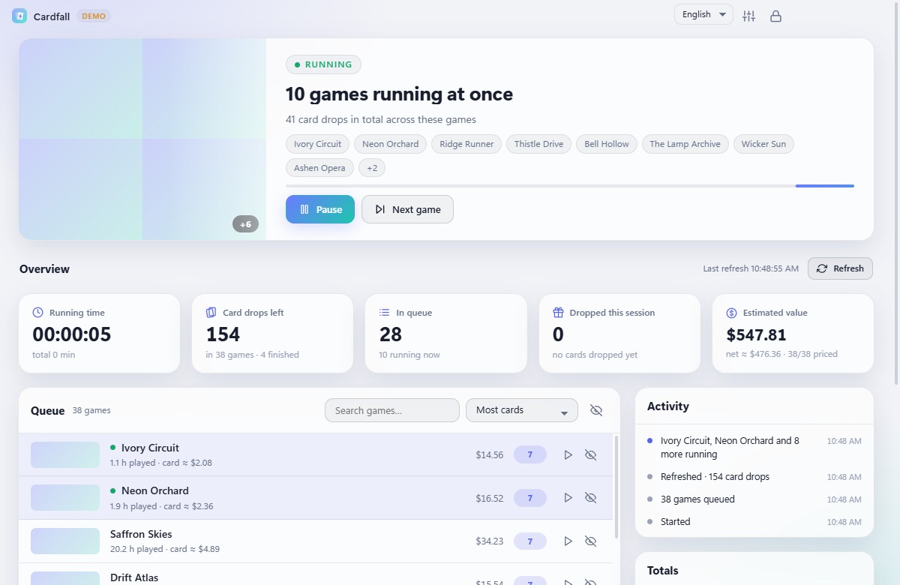
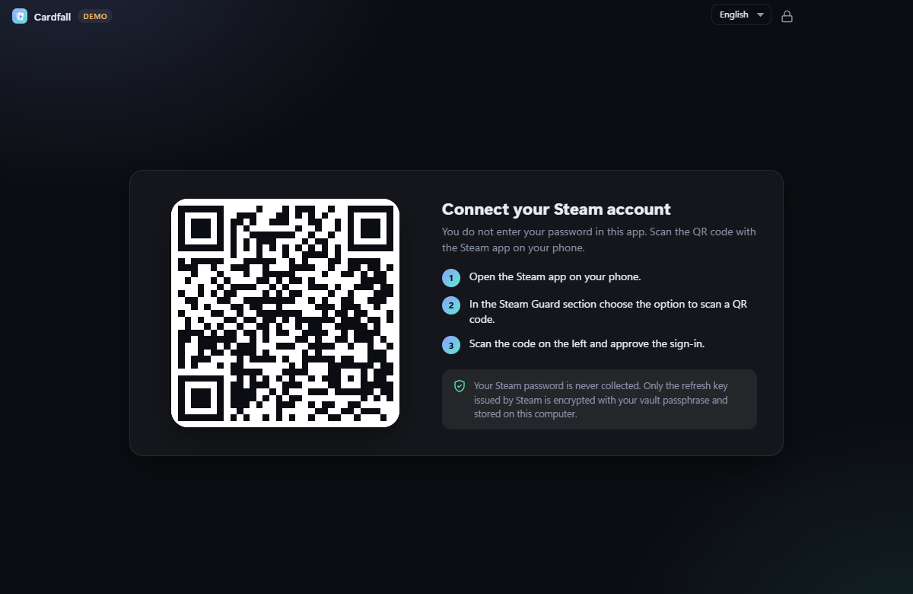
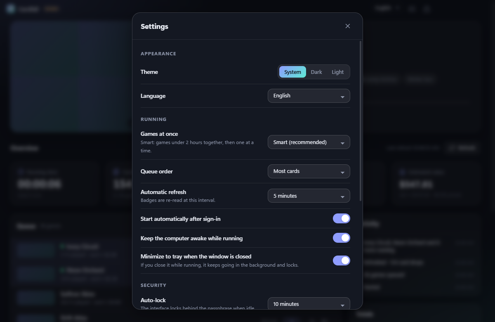

<div align="center">


# Cardfall

**A calm, secure Steam trading card idler for Windows.**
Sign in with a QR code, let your games "play", watch the cards drop.

[](https://github.com/blgymtr/cardfall/actions/workflows/ci.yml)
[](https://github.com/blgymtr/cardfall/releases/latest)
[](LICENSE)

**English** · [Deutsch](README.de.md) · [Türkçe](README.tr.md)


<sub>Screenshots use built-in demo data.</sub>

</div>

## Download

Get the installer from the [latest release](https://github.com/blgymtr/cardfall/releases/latest)
(`Cardfall-Setup-<version>.exe`, Windows 10/11, 64-bit). The installer is **not code-signed**, so Windows SmartScreen
may warn you on first run (More info → Run anyway). Compare the SHA-256 checksum listed in the release if you like.

## Features

- **QR sign-in.** Your Steam password is never typed into or stored by Cardfall.
- **Smart idling.** Games under 2 hours run together (up to 32), then one at a time. Fixed 1 to 32 games is available too.
- **Full control.** Pause and resume, jump to the next game, run a specific game right now, hide games from the queue.
- **Live numbers.** Running time (session and total), remaining card drops, games in the queue, cards dropped this session
  and an estimated value from the Steam Market (net of Steam's fee).
- **Refresh button** and automatic refresh that re-reads your badges and counts new drops.
- **Plays nice with Steam.** If you start a game elsewhere on your account, Cardfall waits and resumes when it is free.
- **Light and dark theme**, **English, German and Turkish** interface (follows your system language, switchable any time).
- **Tray mode.** Closing the window while idling keeps running in the background and locks the interface.

## Security

| Measure | Details |
|---|---|
| No password, QR instead | Your Steam password never enters the app |
| Encrypted vault | The Steam refresh key is encrypted with AES-256-GCM using a key derived from your passphrase (scrypt, N=2^16) and wrapped with Windows DPAPI |
| Attempt limit | Exponential back-off after 3 wrong attempts, the vault is deleted after 10 |
| Auto-lock | On idle, Windows lock, suspend and when hidden to tray. Idling continues while locked |
| Nothing leaks while locked | The locked UI receives no game list or account data |
| Isolated UI | `contextIsolation`, sandbox, no Node, strict CSP with `connect-src 'none'`, the UI cannot reach the internet |
| Narrow IPC | Only validated calls from the app's own page are accepted |
| Network allow-list | Only `steamcommunity.com`, `api.steampowered.com` and the Steam CDN over HTTPS |
| Hardened Electron | `RunAsNode` and `--inspect` off, load from asar only, asar integrity check |
| Private | No telemetry, no ads, no update pings, no open ports |

Read the [security policy](SECURITY.md) for the threat model and how to report an issue.

## Getting started

1. Install and start Cardfall.
2. Choose a passphrase. It protects your saved Steam session on this computer.
3. In the Steam app on your phone open **Steam Guard** and scan the QR code shown by Cardfall, then approve.
4. Cardfall reads your badges and starts idling. That's it.

<details>
<summary>More screenshots</summary>





</details>

## Good to know

- Steam gives no drops for a game before about **2 hours** of play time. New games therefore start dropping later.
- Drops are random and decided by Steam. Cardfall keeps your games "in game", it does not control when a card appears.
- If you launch a game on the same PC, Steam asks to stop the other session. Cardfall detects it and waits.
- Estimated values come from current Steam Market listings and are only a rough guide. Prices are fetched slowly because the Market rate-limits requests.
- Your data lives in `%APPDATA%\Cardfall`. **Settings → Delete all local data** removes everything.

## Disclaimer

Cardfall is an independent hobby project. It is not affiliated with, endorsed or sponsored by Valve Corporation.
Steam and the Steam logo are trademarks of Valve Corporation. Idling games to collect trading cards is a common practice,
but you use this software at your own risk and are responsible for following the Steam Subscriber Agreement.

## Development

```bash
npm install        # electron's postinstall may need: node node_modules/electron/install.js
npm run demo       # open the UI with fake data, no Steam connection
npm test           # unit tests
npm run dist       # build release/Cardfall-Setup-<version>.exe
```

Source layout: `src/main` (vault, Steam session, farming engine, security), `src/preload` (IPC bridge),
`src/renderer` (UI and translations in `i18n.js`). Adding a language means adding a column to `src/renderer/i18n.js`.
Issues and pull requests are welcome.

## License

[MIT](LICENSE) © 2026 Ömer
