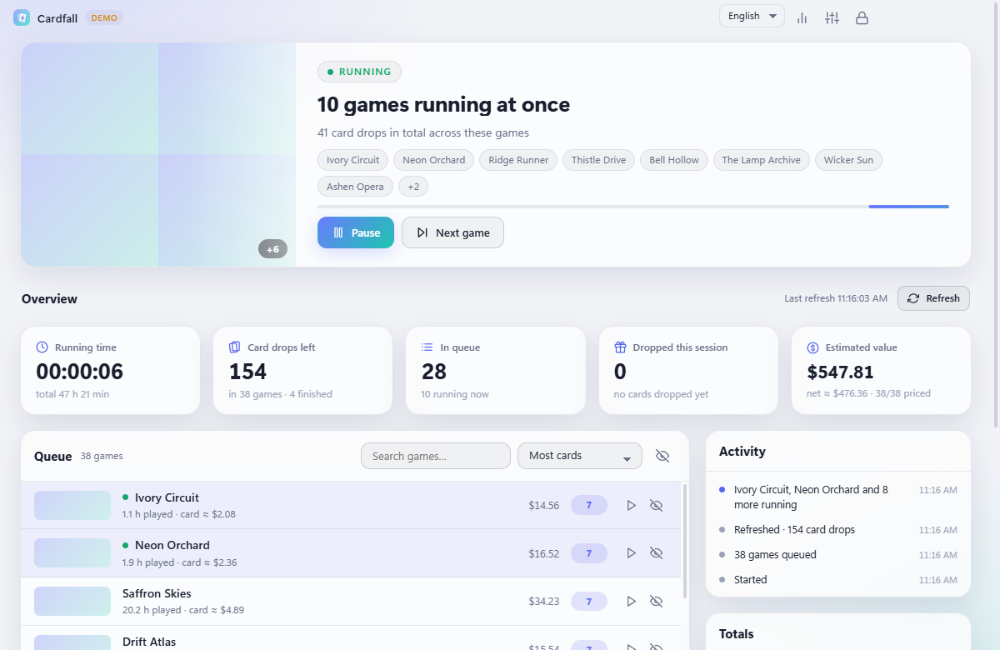
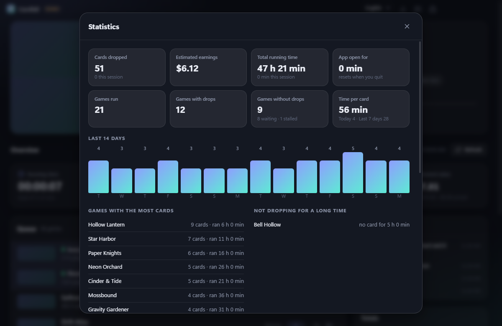
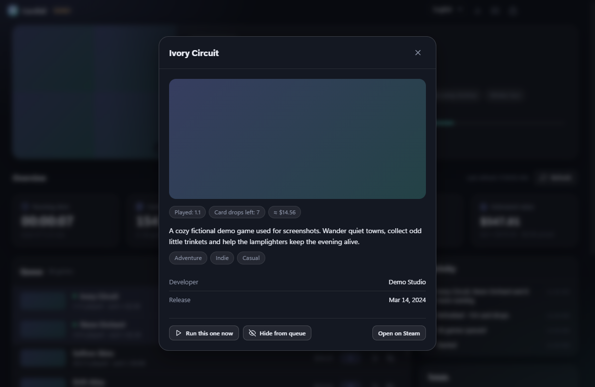
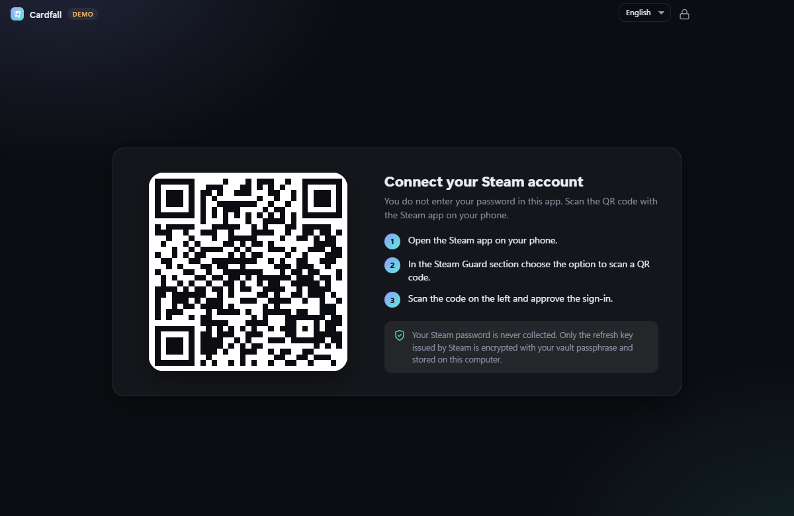
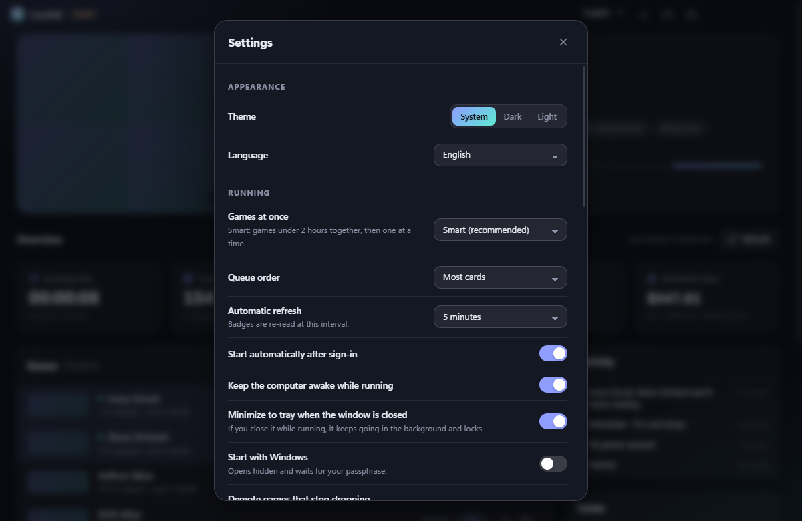

<div align="center">


# Cardfall

**Windows için sakin ve güvenli bir Steam kart düşürme programı.**
QR kodla giriş yap, oyunların "oynuyor" görünsün, kartların düşüşünü izle.

[](https://github.com/blgymtr/cardfall/actions/workflows/ci.yml)
[](https://github.com/blgymtr/cardfall/releases/latest)
[](LICENSE)

[English](README.md) · [Deutsch](README.de.md) · **Türkçe** · [Italiano](README.it.md) · [Français](README.fr.md) · [Español](README.es.md)


<sub>Ekran görüntüleri yerleşik demo verisiyle alınmıştır (İngilizce arayüz).</sub>

</div>

## İndir

Kurulum dosyasını [son sürümden](https://github.com/blgymtr/cardfall/releases/latest) indir
(`Cardfall-Setup-<sürüm>.exe`, Windows 10/11, 64 bit). Kurulum dosyası **imzasız** olduğu için Windows SmartScreen ilk açılışta uyarı
verebilir ("Ek bilgi" → "Yine de çalıştır"). İstersen sürüm sayfasındaki SHA-256 sağlama toplamını karşılaştırabilirsin.

## Özellikler

- **QR ile giriş.** Steam parolan Cardfall'a hiç girilmez, saklanmaz.
- **Akıllı çalışma.** 2 saatin altındaki oyunlar birlikte (en çok 32), sonra tek tek çalışır. İstersen sabit 1 ile 32 oyun seçebilirsin.
- **Takılan oyun geri alınır.** 2 saati geçmiş bir oyun kart vermeyi keserse, seçtiğin süre sonunda sıranın sonuna alınır.
- **Tam kontrol.** Duraklat ve devam et, sıradaki oyuna geç, belirli bir oyunu hemen çalıştır, oyunları sıradan gizle.
- **Güncel kalan oyun bilgisi.** Her oyunun görseli görünür; klasik adres yoksa mağazanın güncel görseline geçilir. Oyuna tıklayınca açıklama, tür, geliştirici ve çıkış tarihi görünür. Görseller ve bilgiler önbelleğe alınır ve 7 günde bir arka planda yenilenir.
- **Canlı sayılar ve istatistikler.** Çalışma süresi (oturum ve toplam), kalan kart, sıra, düşen kart, çalıştırılan oyun, kart düşen ve düşmeyen oyun sayısı, 14 günlük grafik, en çok kart veren oyunlar, son düşenler ve Steam Pazarı'ndan tahmini değer (Steam kesintisi düşülmüş net).
- **Yenile tuşu** ve rozetleri yeniden okuyup yeni düşenleri sayan otomatik yenileme.
- **Steam ile uyumlu.** Hesabında başka yerde oyun açarsan Cardfall bekler, boşalınca devam eder.
- **Windows ile başlat** (gizli açılır, parolanı bekler) ve **tepsi modu**: çalışırken pencereyi kapatırsan arka planda sürer ve arayüz kilitlenir.
- **Altı dil**: English, Deutsch, Türkçe, Italiano, Français, Español. Açık ve koyu tema.
- **Veri ve gizlilik araçları.** Güncel oturumu gör, etkinlik günlüğünü temizle, kart geçmişini sil, önbelleği temizle, istatistikleri sıfırla, oturumu kapat, hesaptan tamamen çık (tüm hesap verisi silinir) ya da her şeyi sil. Silmeden önce dosyaların üzerine rastgele veri yazılır.

## Güvenlik

| Önlem | Ayrıntı |
|---|---|
| Parola yok, QR var | Steam parolan uygulamaya hiç girmez |
| Şifreli kasa | Steam yenileme anahtarı, parolandan türetilen anahtarla (scrypt, N=2^17) AES-256-GCM ile şifrelenir ve ayrıca Windows DPAPI ile sarılır. Eski kasalar otomatik yükseltilir |
| Parola kuralı | En az 10 karakter, yaygın ve basit parolalar reddedilir |
| Deneme sınırı | 2. yanlıştan itibaren bekleme artar, 10 yanlışta kasa silinir. Sayaç kasa dosyasının içindedir |
| Otomatik kilit | Hareketsizlikte, Windows kilitlenince, uykuya geçince, isteğe bağlı küçültünce ve tepsiye küçülünce. Kilitliyken çalışma sürer |
| Anahtar bellekten silinir | Kilitlenince şifreleme anahtarı silinir, kilit açılınca yeniden türetilir |
| Kilitliyken veri yok | Kilitli arayüze oyun listesi ya da hesap bilgisi gönderilmez |
| Mühürlü yerel veri | Ayarlar, istatistikler ve geçmiş Windows DPAPI ile şifrelenir |
| İzole arayüz | `contextIsolation`, sandbox, Node yok, `connect-src 'none'` ve Trusted Types ile katı CSP, arayüz internete çıkamaz |
| Dar, hız sınırlı IPC | Yalnızca uygulamanın kendi sayfasından gelen doğrulanmış çağrılar, saniyede en çok 50 |
| Ağ izin listesi | Yalnızca HTTPS ile `steamcommunity.com`, `store.steampowered.com`, `api.steampowered.com` ve Steam görsel CDN'i, TLS doğrulaması zorunlu |
| Sertleştirilmiş Electron | `RunAsNode` ve `--inspect` kapalı, yalnızca asar'dan yükleme, asar bütünlük denetimi, izin yok, webview yok |
| İsteğe bağlı yakalama engeli | Pencere ekran görüntüsü ve paylaşımından gizlenebilir |
| Kalıcı silme | Dosyalar kaldırılmadan önce rastgele veriyle üzerine yazılır |
| Tedarik zinciri | Bağımlılıklar denetlendi (üretimde bilinen açık yok), Dependabot, kaynak doğrulamalı sürüm derlemeleri |
| Gizlilik | Telemetri, reklam, güncelleme sorgusu, açık port yok |

Tehdit modeli ve bildirim yolu için [güvenlik politikasına](SECURITY.md) (İngilizce) bak.

## Başlarken

1. Cardfall'ı kur ve aç.
2. Bir parola belirle. Bu parola, bu bilgisayardaki kayıtlı Steam oturumunu korur.
3. Telefondaki Steam uygulamasında **Steam Guard**'ı aç, Cardfall'ın gösterdiği QR kodu okut ve onayla.
4. Cardfall rozetlerini okur ve çalışmaya başlar. Hepsi bu.

<details>
<summary>Daha fazla ekran görüntüsü</summary>







</details>

## Bilmen gerekenler

- Steam, bir oyunda yaklaşık **2 saat** oynamadan kart düşürmez. Yeni oyunlar bu yüzden daha geç düşürmeye başlar.
- Kartlar rastgele düşer ve zamanı Steam belirler. Cardfall oyunlarını "oyunda" tutar, kartın ne zaman çıkacağını kontrol etmez.
- Aynı bilgisayarda bir oyun açarsan Steam diğer oturumu kapatmak ister. Cardfall bunu algılar ve bekler.
- Tahmini değerler Steam Pazarı'ndaki güncel ilanlardan gelir, yalnızca kaba bir fikir verir. Pazar istekleri sınırladığı için fiyatlar yavaş alınır.
- Verilerin `%APPDATA%\Cardfall` klasöründe durur. **Ayarlar → Veri ve gizlilik** bunları yönetir ve siler.
- Silmeden önce üzerine yazmak elinden gelen en iyi çabadır: SSD'lerde aşınma dengeleme eski blokları tutabilir. Steam anahtarı zaten her zaman şifreli saklanır.

## Sorumluluk reddi

Cardfall bağımsız bir hobi projesidir. Valve Corporation ile bağlantısı yoktur, Valve tarafından onaylanmamış ya da desteklenmemiştir.
Steam ve Steam logosu Valve Corporation'ın ticari markalarıdır. Kart toplamak için oyun "idle" etmek yaygın bir uygulamadır,
ancak yazılımı kendi sorumluluğunda kullanırsın ve Steam Abone Sözleşmesi'ne uymaktan sen sorumlusun.

## Geliştirme

```bash
npm install        # gerekirse: node node_modules/electron/install.js
npm run demo       # Steam'e bağlanmadan sahte verilerle arayüzü aç
npm test           # birim testleri
npm run dist       # release/Cardfall-Setup-<sürüm>.exe üret
```

Yapı: `src/main` (kasa, Steam oturumu, motor, güvenlik), `src/preload` (IPC köprüsü),
`src/renderer` (arayüz; çeviriler `i18n.js` ve `i18n-more.js` içinde). Yeni dil eklemek oralara bir sütun eklemek demektir;
bir test her anahtarın her dilde aynı yer tutucularla bulunduğunu denetler.
Issue ve pull request'ler memnuniyetle karşılanır.

## Lisans

[MIT](LICENSE) © 2026 Ömer
